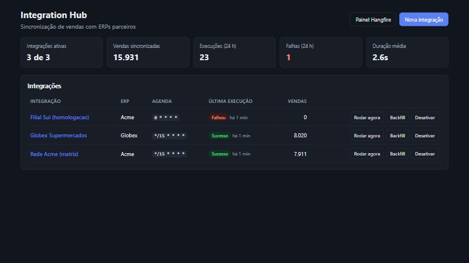
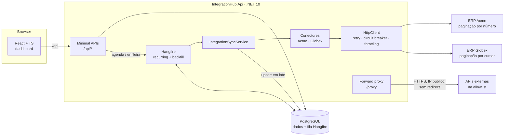
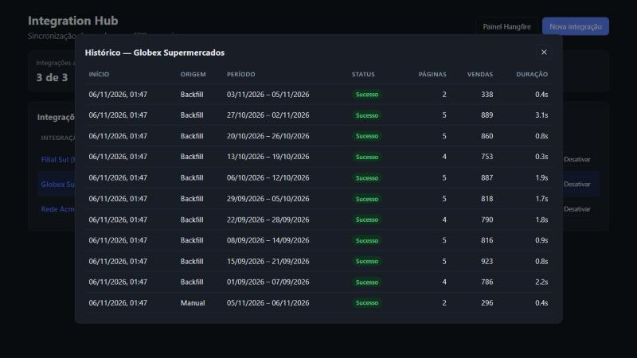

# Integration Hub

[](https://github.com/pehlage/integration-hub/actions/workflows/ci.yml)


Hub de integração que **puxa vendas de vários ERPs de parceiros**, normaliza num modelo único e grava de forma
idempotente. Os jobs rodam em background com Hangfire e aguentam ERP lento, limite de requisições e instabilidade.
Um painel em React mostra o status de cada integração e permite ativar, rodar ou reprocessar períodos.



## O problema

Toda empresa que vende por canais parceiros acaba com o mesmo cenário: cada parceiro tem um ERP diferente, com
paginação, formato de dados e limites próprios. A sincronização precisa:

- **rodar sozinha**, em agenda, sem alguém disparar planilha;
- **não perder nem duplicar** dados quando o ERP cai no meio da paginação ou a mesma janela roda de novo;
- **respeitar o limite** de requisições do parceiro (senão ele bloqueia);
- **recuperar histórico**: um parceiro novo pede, por exemplo, os últimos 3 anos de vendas;
- ser **observável**: dá para ver, sem abrir log, o que rodou, o que falhou e por quê.

Os dois ERPs deste repositório (`Acme` e `Globex`) são **simulados**. Eles ficam no projeto `MockErp`, geram dados
determinísticos e injetam falhas (`503` e `429` com `Retry-After`) de propósito.

## Arquitetura



| Projeto | Papel |
|---|---|
| `src/IntegrationHub.Api` | API, jobs Hangfire, conectores, proxy |
| `src/IntegrationHub.MockErp` | Dois ERPs falsos com falhas injetadas |
| `tests/IntegrationHub.Tests` | xUnit: unidade + integração (API e ERP sobem em memória) |
| `web` | Dashboard React + TypeScript + Vite |

## Decisões técnicas

**Hangfire com storage no próprio Postgres.** A fila sobrevive a restart e não exige Redis ou um broker a mais para
operar. Cada integração ativa vira um *recurring job* com o cron dela. Ao desativar, o job é removido.
`DisableConcurrentExecution` impede duas execuções da mesma integração ao mesmo tempo.

**Janela recorrente de "ontem + hoje".** ERP costuma lançar venda com atraso. Reler o dia anterior custa pouco e
evita buraco. Isso só é seguro porque a gravação é idempotente (ver abaixo).

**Upsert idempotente em lote.** Cada venda tem chave única `(IntegrationId, ExternalId)`. A gravação usa
`INSERT … SELECT FROM UNNEST(@arrays) ON CONFLICT DO UPDATE`: um round-trip por lote de 500, em vez de um
`SELECT` + `INSERT`/`UPDATE` por linha. Rodar a mesma janela duas vezes não duplica nada, e há teste cobrindo isso.

**Backfill quebrado em janelas de 7 dias.** Carregar 3 anos num único job significa que uma falha no fim joga
tudo fora. Aqui cada janela é um job independente: se uma falha, o Hangfire reexecuta **só ela**, e as janelas
rodam em paralelo até o limite de workers.

**Resiliência com `Microsoft.Extensions.Http.Resilience` (Polly v8).**

- Retry exponencial com *jitter*, respeitando o `Retry-After` do `429`.
- Circuit breaker, para não martelar um ERP que caiu.
- Timeout por tentativa e timeout total.

**Throttling próprio por host** (`DelegatingHandler`). Ele limita as requisições simultâneas e impõe um intervalo
mínimo entre elas. Fica *dentro* do pipeline de resiliência, então cada retry também passa pelo limitador e o
parceiro nunca recebe uma rajada.

**Conectores atrás de uma interface.** `IErpConnector` expõe as páginas como `IAsyncEnumerable`. Cada ERP tem
paginação diferente (número de página × cursor) e formato diferente, e o serviço de sincronização não conhece
nenhum dos dois. Adicionar um ERP novo é escrever uma classe.

**Forward proxy seguro.** Serve para o front ou um parceiro chamar APIs externas sem expor credenciais. Um proxy
aberto é porta de entrada para SSRF, então tudo é negado por padrão:

- só HTTPS, host em allowlist (aceita `*.dominio.com`), sem credencial embutida na URL;
- bloqueio de IP privado, loopback, link-local (inclui `169.254.169.254`, o *metadata* de cloud), CGNAT e
  multicast, inclusive IPv4 mapeado em IPv6;
- a checagem de IP é feita **no momento da conexão** (`ConnectCallback`), não só na validação da URL. Isso fecha
  a brecha de DNS rebinding;
- `AllowAutoRedirect = false`, porque um redirect levaria para fora da allowlist;
- API key comparada em tempo constante (`CryptographicOperations.FixedTimeEquals` sobre hash);
- o header `X-Proxy-Error` diferencia "o proxy bloqueou" de "o destino respondeu erro".

**Falha registrada, não engolida.** Toda execução vira um `JobRun` com período, páginas, registros, duração e erro.
O painel e o endpoint `/api/dashboard` leem dali.

**Front com React Query.** O cache e o *polling* a cada 5 s mantêm o painel atualizado sem WebSocket. As
mutations invalidam as queries, então a tela reflete a ação na hora.

## Como rodar

### Tudo com Docker

```bash
docker compose up --build
```

| Serviço | URL |
|---|---|
| Dashboard | http://localhost:8080 |
| API (OpenAPI em `/openapi/v1.json`) | http://localhost:5000 |
| Painel Hangfire | http://localhost:5000/hangfire |
| ERP simulado | http://localhost:5080 |

Duas integrações de exemplo já sobem cadastradas e começam a sincronizar no próximo ciclo do cron. Para ver dados
na hora, use **Rodar agora** ou **Backfill** no painel.

### Sem Docker (banco em memória)

Requer .NET 10 SDK e Node 20.19+.

```bash
dotnet run --project src/IntegrationHub.MockErp   # porta 5080
dotnet run --project src/IntegrationHub.Api       # porta 5000, Postgres e Hangfire em memória
cd web && npm install && npm run dev              # http://localhost:5173
```

### Testes

```bash
dotnet test          # 50 testes: proxy, janelas, throttling, conectores, sync com falhas, API
cd web && npm test   # Vitest + Testing Library
```

Os testes de sincronização sobem o ERP simulado em memória (`WebApplicationFactory`) com **25% das requisições
falhando**. Eles verificam que a sincronização entrega todas as vendas, sem duplicar, mesmo assim.

## Endpoints principais

| Método | Rota | Descrição |
|---|---|---|
| `GET` | `/api/dashboard` | Totais e métricas das últimas 24 h |
| `GET` | `/api/integrations` | Integrações com status da última execução |
| `POST` | `/api/integrations` | Cria integração (valida URL e cron) |
| `POST` | `/api/integrations/{id}/enable` · `/disable` | Liga/desliga o agendamento |
| `POST` | `/api/integrations/{id}/run` | Enfileira execução manual |
| `POST` | `/api/integrations/{id}/backfill` | Enfileira carga histórica (até 3 anos) |
| `GET` | `/api/integrations/{id}/runs` | Histórico de execuções |
| `POST` | `/proxy` | Forward proxy seguro (header `X-Api-Key`) |



## O que eu faria a seguir em produção

- Migrations do EF Core no lugar de `EnsureCreated`.
- Autenticação no painel e no Hangfire Dashboard (hoje aberto para facilitar a demo).
- Segredos em secret manager, não em `appsettings`/variável de ambiente.
- Métricas OpenTelemetry (duração por integração, taxa de retry) e alerta quando a integração falha N vezes seguidas.
